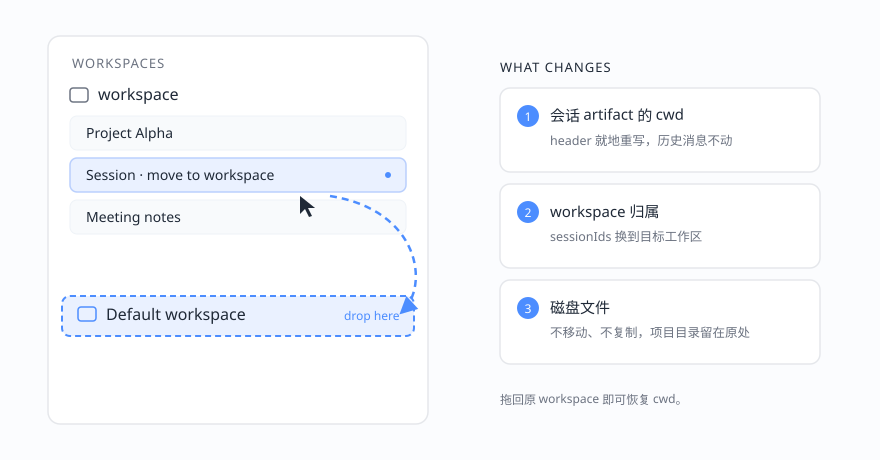

# dsh-drag-workspace

> Drag a session row in the DSH sidebar onto another workspace header to move
> that session there.



[中文](README.md)

## Why

DSH already ships row dragging, but only for reordering:

- session row ↔ session row in the same group → reorder inside the workspace
  (`workspace/insertSessionBefore`);
- workspace row ↔ workspace row with the same parent → reorder workspaces
  (`insertWorkspaceBefore`).

Dropping a session **onto another workspace header** is not wired, so the
cursor shows "not allowed". This plugin adds exactly that drop target.

## Install

Requires DSH 0.2.x with the default JSONL/Zstd session backend (it exposes the
`locate` seam the move needs).

```bash
# Web profile
dsh plugin --profile web add dsh-drag-workspace

# Desktop: Plugins → Add plugin → dsh-drag-workspace
```

No other plugin is required. The move implementation is built in.

For local development, install a checkout:

```bash
dsh plugin --profile web add link:/path/to/dsh-drag-workspace
```

## What a drag changes

The move is a real re-home, not a cosmetic group change:

| Layer | Changed? |
| --- | --- |
| Files on disk / project folder | No — nothing is copied or moved |
| Workspace registry (`sessionIds`) | Yes — the session is re-accounted |
| Session artifact header `cwd` | Yes — rewritten in place |
| Live agent working directory | Yes — rebound when the session is running |

Because `cwd` changes, the session's tools, `@file` references, `AGENTS.md`
resolution and sandbox root follow the new directory. Drag it back to restore
the old one.

## How it works

Client (`lib/client.js`):

- document-level `dragstart` / `dragover` / `drop` listeners, no React, no
  sidebar replacement;
- reads `data-row-key="session:<id>"` and `data-row-key="workspace:<id>"`
  from the native rows;
- highlights the hovered workspace header and posts
  `POST /dsh-drag-workspace/api/move`.

Host (`lib/index.js`):

- registers that endpoint behind owner-only `connection.admit()` auth;
- runs the move pipeline: rewrite the artifact `cwd`, relocate the artifact,
  swap workspace accounting, rebind the live persistence writer, refresh the
  projection cache;
- same-directory drops only repair membership, and failures roll back instead
  of leaving a half-moved session.

### Vendored move pipeline

The pipeline is vendored verbatim from
[`dsh-session-manager`](https://github.com/hkkz9522/dsh-session-manager)
v0.7.8 (MIT — see `lib/vendor/session-manager/LICENSE`). It is booted against a
shadow context whose `effect`/`on` hooks are inert, so its HTTP API, boot
reconciliation and update checks never run; only `moveSession` is used.

## Compatibility

| DSH | plugin |
| --- | --- |
| 0.2.2-rc.1 (Desktop) | 0.2.0 |
| 0.2.x | 0.2.0 |

## Limits

- the workspace header is the only drop target; dropping between rows keeps the
  native reorder, and "Ungrouped" is not a move target;
- archived and blank sessions are not draggable (native rule);
- sessions with a Git worktree are rejected by the host;
- the vendored pipeline tracks upstream v0.7.8 and must be re-synced by hand
  when upstream changes.

## Related plugins

Two plugins already move sessions across workspaces:
[`dsh-workspace-mover`](https://github.com/PianoPrince/dsh-workspace-mover) (move
history, one-click undo, orphan recovery, agent tools) and
[`dsh-session-drag-move`](https://github.com/FurryBear2025/dsh-session-drag-move).
This plugin deliberately stays smaller: the move pipeline is vendored so there is
no third-party plugin dependency, it exposes no extra HTTP API beyond one
owner-only endpoint, and dragging is the only trigger. If you want history, undo
or agent-facing tools, install `dsh-workspace-mover` instead.

## Development

```bash
npm run check   # syntax check
npm test        # client drag wiring + host route + real artifact move
```

`test/host-move.mjs` moves a synthetic session artifact inside a throwaway
`DSH_HOME`, so it never touches a real session.

## License

MIT. The vendored pipeline keeps its own MIT license and copyright.
