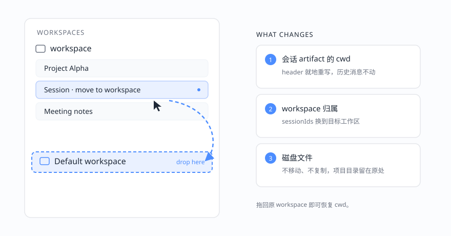

# 会话拖拽搬家（dsh-drag-workspace）

> 把 DSH 侧栏里的会话行拖到另一个 workspace 标题上，就把这个会话移动到那个工作区。



[English](README.en.md)

## 为什么需要它

DSH 原生已经支持拖拽，但只有两种落点：

- 会话行 ↔ 同组会话行 → 组内排序（`workspace/insertSessionBefore`）；
- workspace 行 ↔ 同级 workspace 行 → 同级排序（`insertWorkspaceBefore`）。

把会话**拖到另一个 workspace 标题**这个落点没有接，光标会显示禁止。本插件只补这一件事。

## 安装

需要 DSH 0.2.x，且使用默认的 JSONL/Zstd 会话持久化后端（移动依赖它暴露的 `locate`）。

```bash
# Web profile
dsh plugin --profile web add dsh-drag-workspace

# Desktop：插件 → 添加插件 → 输入 dsh-drag-workspace
```

不需要安装任何其他插件，移动实现已内置。

本地开发装 checkout：

```bash
dsh plugin --profile web add link:/path/to/dsh-drag-workspace
```

## 拖一下到底改了什么

这是真实的“搬家”，不是只改分组显示：

| 层面 | 是否变化 |
| --- | --- |
| 磁盘文件 / 项目目录 | 否，不复制也不移动 |
| workspace 注册表（`sessionIds`） | 是，会话归属换到目标工作区 |
| 会话 artifact header 的 `cwd` | 是，就地重写 |
| 运行中 agent 的工作目录 | 是，同步重绑 |

因为 `cwd` 变了，这个会话的工具默认路径、`@文件` 相对引用、`AGENTS.md` 解析和沙箱根都会跟着变；拖回去即可恢复。

## 实现

客户端（`lib/client.js`）：

- 只挂 document 级 `dragstart` / `dragover` / `drop`，不替换侧栏、不写 React 组件；
- 从原生行上读 `data-row-key="session:<id>"` 与 `data-row-key="workspace:<id>"`；
- 悬停时高亮目标 workspace 标题，松手调用 `POST /dsh-drag-workspace/api/move`。

宿主（`lib/index.js`）：

- 注册上面的端点，走 owner-only 的 `connection.admit()` 鉴权；
- 执行移动管线：重写 artifact `cwd`、把 artifact 迁到目标工作区目录、交换 workspace 归属、
  重绑运行中会话的持久化 writer、刷新投影缓存；
- 同目录会话只补归属；失败按上游语义回滚，不会留下半移动状态。

### 内嵌的移动管线

这套逻辑内嵌自 [`dsh-session-manager`](https://github.com/hkkz9522/dsh-session-manager)
v0.7.8（MIT，见 `lib/vendor/session-manager/LICENSE`）。启动时给它套一层 shadow
context，让它的 `effect`/`on` 失效——它的 HTTP API、启动对账和自动更新检查都不会运行，
只有 `moveSession` 生效。

## 兼容性

| DSH | 插件 |
| --- | --- |
| 0.2.2-rc.1（Desktop） | 0.2.0 |
| 0.2.x | 0.2.0 |

## 已知边界

- 只认 workspace 标题作为落点；行与行之间仍走原生排序，「未分组」不能作为目标；
- 归档会话、空白会话原生不可拖；
- 带 Git worktree 的会话会被宿主拒绝；
- 内嵌管线锁在上游 v0.7.8，上游升级后需手动同步。

## 同类插件

已经有两个插件在做同一件事： [`dsh-workspace-mover`](https://github.com/PianoPrince/dsh-workspace-mover)
（移动历史、一键撤回、失联会话恢复、agent 工具）和
[`dsh-session-drag-move`](https://github.com/FurryBear2025/dsh-session-drag-move)。
本插件刻意保持更小：移动管线内嵌，因此不依赖任何第三方插件；除一个 owner-only
端点外不额外暴露 HTTP API；触发方式只有拖拽。需要历史、撤回或面向 agent 的工具，
请改装 `dsh-workspace-mover`。

## 开发与测试

```bash
npm run check   # 语法检查
npm test        # 客户端拖拽 + 宿主路由 + 真实 artifact 移动
```

`test/host-move.mjs` 在临时 `DSH_HOME` 里搬一个合成会话，不碰真实会话。

## 许可

MIT。内嵌管线保留其自身的 MIT 许可与版权声明。
